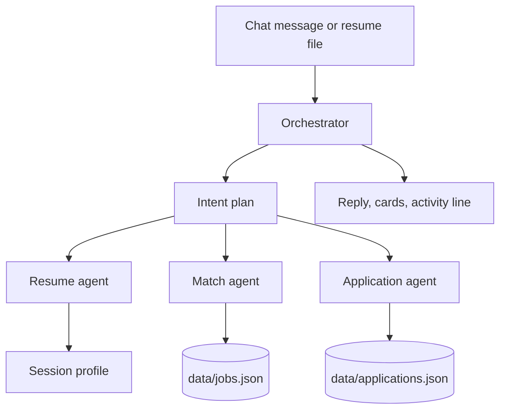

# Job Chat Assistant

A conversational assistant that reads a resume, recommends roles from a local dataset of real postings, and records an application when you ask. No account, no login.

## Run it locally

Python 3.12.

```bash
python -m venv .venv
.venv\Scripts\activate
pip install -r requirements.txt
python scripts/scrape_jobs.py
uvicorn app.main:app --host 127.0.0.1 --port 8000
```

In a second terminal, start the dashboard:

```bash
cd frontend
npm install
npm run dev
```

Open http://127.0.0.1:5173 and upload your own PDF or DOCX resume. The dev server forwards `/api` to the API on port 8000.

`scripts/scrape_jobs.py` writes `data/jobs.json` from live Greenhouse, Lever, and Ashby boards. That file is the only job database. There is no hand-written job list. Applications land in `data/applications.json`. Chat state sits in `data/sessions.json` (gitignored).

To let the chat read looser sentences ("only frontend roles", "remote React jobs in Berlin"), copy `.env.example` to `.env` and set `GEMINI_API_KEY`. The model only classifies the sentence. Roles still come from `jobs.json`. Without a key, the built-in phrases still work.

```bash
pip install -r requirements-dev.txt
pytest
```

## What a conversation looks like

1. Drop a PDF or DOCX resume into the chat. The assistant reads it and shows name, contact, designation, skills, experience, education, and projects.
2. It recommends roles from the dataset, each with a short reason.
3. Narrow it in plain language: "show only remote roles", "jobs needing React", "in Berlin", "intern roles", "show more".
4. "apply to job 3" records that role. Asking again does not create a second row.
5. "show my applied jobs" lists what was saved: job id, date, and status.

Correct a bad parse with "my title is Data Analyst" or "I have 4 years" or "I know Figma".

Cards and suggestion chips only send the sentence you could have typed. Matching and applying still go through the same chat turn.

## Agent architecture

One orchestrator, three specialists. The orchestrator does not score jobs or write the application file itself.



- **Orchestrator** (`app/agents/orchestrator.py`) reads the turn, asks `interpret()` for a plan, then calls the specialist that plan names. The activity line in the chat ("Read the resume · Compared the profile with N listings") is that plan, not a hidden chain of thought.
- **Resume agent** (`app/agents/resume.py`) pulls text out of PDF (pypdf) or DOCX (python-docx, including tables) and fills the profile fields. A scan with no text layer, a password-protected PDF, or a file that isn't a resume comes back as a normal chat message.
- **Match agent** (`app/agents/matcher.py`) scores each posting on skill overlap, title similarity, and years. Weak skills that appear on almost every posting (git, agile, HTML) barely move the score. Filters from chat — remote, a required skill, a city, intern/junior/senior — are applied before scoring. One employer can't take over the whole page.
- **Application agent** (`app/agents/applications.py`) resolves "job 3", "the second one", or a pasted job id against the list just shown. It inserts one row per person per job.

Replies are assembled from those tool results. A match reason only mentions skills, title, and years that were actually compared, so the sentence can't invent a technology the resume doesn't have. There is no hosted model in the default setup; the demo works without an API key.

Until a resume has an email, applications are keyed by the browser session id. After that they follow the email, so uploading the same resume again still finds them. That is a stable key, not an account.

## Data flow

1. `scripts/scrape_jobs.py` downloads a public directory of board slugs, then reads each employer's own job-board API.
2. `app/ingest.py` turns those payloads into one shape: id, title, company, location, experience required, skills, a plain-text description excerpt, source link, plus `source`, `remote`, and `experience_years_min` for filtering.
3. On startup the server loads `data/jobs.json` into memory and keeps a skill set and a search blob on each row so a chat turn doesn't re-parse HTML.
4. A `POST /api/chat` turn updates the session, maybe the application file, and returns the reply plus structured cards.
5. The browser renders the cards. Refresh reloads the session from `GET /api/session/{id}`.

Descriptions are clipped excerpts. `source_link` is the original posting.

## APIs used

No API keys.

| Source | What we call | Why |
| --- | --- | --- |
| [Job board directory](https://kalebconfer-sys.github.io/job-board-directory/) | `greenhouse.csv`, `ashby.csv`, `lever.csv` | Public list of board slugs. We don't guess tokens. |
| Greenhouse Job Board API | `GET https://boards-api.greenhouse.io/v1/boards/{token}/jobs?content=true` | Public careers-page feed. No auth on GET. |
| Lever Postings API | `GET https://api.lever.co/v0/postings/{slug}?mode=json` (EU host if the US one 404s) | Same idea, Lever-hosted boards. |
| Ashby posting API | `GET https://api.ashbyhq.com/posting-api/job-board/{name}` | Same idea, Ashby-hosted boards. |

The script caps how many roles it keeps from a single board, skips boards that error, and stops around 1,850 jobs (never more than 2,000). Re-run it any time; live postings change.

```bash
python scripts/scrape_jobs.py
python scripts/scrape_jobs.py --target 1800 --out data/jobs.json
```

## HTTP API

`POST /api/chat` as multipart form data:

| Field | |
| --- | --- |
| `message` | What the person typed. Can be empty if a file is attached. |
| `session_id` | Empty on the first turn. Send back the id from the previous response. |
| `file` | Optional PDF or DOCX, up to 4 MB. |

The JSON body includes `reply`, `jobs` (cards for this list), `profile`, `filters`, `saved_applications`, `activity`, and `suggestions`.

`GET /api/health` — job count and source breakdown.

`GET /api/session/{session_id}` — profile, transcript, and that person's applications.

`GET /api/jobs/{job_id}` — one stored posting.

Errors that belong in the conversation (unreadable resume, no matches, job 9 when the list has 5, a duplicate application) come back as the assistant's reply with HTTP 200. A broken turn is logged on the server and answered with a short retry message instead of a stack trace.

## Application records

`data/applications.json`:

```json
{
  "job_id": "gh_gitlab_123",
  "applied_date": "2026-10-19",
  "status": "not_submitted"
}
```

The file also keeps the applicant key, name, title, company, and source link so "show my applied jobs" can name the role. Status is `not_submitted` until the company form is finished on their site. The same applicant and job id cannot be inserted twice.

Recording an application writes this file. It does not submit the employer's own form — those endpoints need the employer's credentials, and the product requirement here is the saved row plus the link to the posting.

## Deploy

The API and the dashboard deploy separately.

**Backend on Render.** New Web Service from this repo, root directory blank. `render.yaml` installs Python and starts uvicorn. Health check is `/api/health`. Optional: set `GEMINI_API_KEY` in the Render environment. Do not commit that key. A free instance sleeps, and its disk is ephemeral, so `applications.json` lasts for the life of that process. `jobs.json` is in the repo and is read on startup.

**Frontend on Vercel.** Import the same repo, set the root directory to `frontend`, framework Vite. Add `VITE_API_URL` as the Render origin with no trailing slash, for example `https://job-chat-assistant.onrender.com`. Redeploy the frontend after that value changes, because Vite bakes it in at build time.

## Layout

```
app/main.py                  HTTP
app/agents/orchestrator.py   turn loop
app/agents/intents.py        which tool to call
app/agents/resume.py         PDF / DOCX parse
app/agents/matcher.py        scoring and filters
app/agents/applications.py   apply + status
app/ingest.py                ATS payload -> job record
app/skills.py                shared skill vocabulary
app/store.py                 jobs.json, applications.json, sessions
scripts/scrape_jobs.py       build the dataset
frontend/                    React dashboard, deployed on Vercel
scripts/make_sample_resume.py  test resume used by pytest only
```
